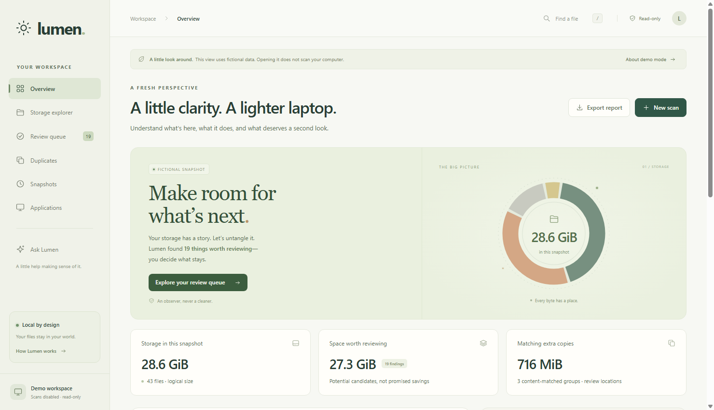

# Lumen

**A little clarity. A lighter laptop.**

A local, read-only laptop auditor with an evidence-first dashboard and optional local AI. Understand your files, identify exact duplicates, investigate generated project folders, and see what changed between scans. Lumen never deletes, moves, uninstalls, or executes generated commands.

**Free to run. No account, API key, paid hosting, build step, or third-party Python package required.** Bring Python 3.10+ and a modern browser. Optional Ollama models run on your own hardware.



## Browser demo

Open the [Lumen Audit demo](https://deba-maity.github.io/lumen-audit/) to explore fictional snapshots, compare their contents, export a report, or try the rule-based evidence guide. Download the local app from the demo to scan folders or connect to a local Ollama model.

To build the static demo, run `python scripts/build_pages_demo.py dist/pages` with a fresh output directory.

## Start on your laptop

1. Copy or extract this project into a writable folder.
2. On Windows, double-click **Start Lumen.cmd**. Or open a terminal in this folder:

   ```sh
   python run.py
   ```

3. Your browser opens to the local address printed in the terminal. Lumen starts with a **fictional demo**, not a scan of your computer.
4. Click **New scan**, enter one or more absolute local folder paths, and start the scan. Downloads or a projects folder is a useful first scope. Add a drive root such as `C:\` only when you want a broad inventory; system locations remain excluded and large inventories may hit the scan limits.
5. Explore the review queue, inspect the evidence, and export a report. Close the terminal with `Ctrl+C` when finished.

No administrator rights are needed. No Windows services, startup tasks, firewall exceptions, registry changes, or installers are created.

The default address is `http://127.0.0.1:8765`. If that port is blocked or occupied, Lumen automatically chooses a free port and prints it. Only the loopback interface is used.

### On a remote desktop: demo only

Double-click **Start Demo.cmd**, or run:

```sh
python run.py --demo-only
```

This mode **rejects scan requests at the backend before inspecting paths**, not just in the UI. It also refuses to load saved live snapshots, even when a state database already exists. All demo files, applications, hashes, and history are fictional. You can test browsing, search, review labels, snapshot comparison, the evidence guide, and exports without auditing the host.

```sh
python run.py --demo-only --no-browser   # Do not open a visible browser
python run.py --port 0                  # Ask the OS for an available port
python run.py --state-dir ./my-state    # Choose Lumen's own storage directory
```

## What works

| Feature | What it actually does |
| --- | --- |
| Storage overview | Logical byte totals, category ring, proportional category map, and top review candidates |
| File explorer | Search paths, drill into the largest folders, filter categories, sort size/date/name, paginate, and inspect per-file explanations and timestamps |
| Review queue | Evidence, likely purpose, uncertainty, consequences, and “keep” labels scoped to the selected snapshot and browser |
| Duplicate detection | Optional full SHA-256 verification of same-size files; does not count hard links twice |
| Project analysis | Recognizes `node_modules`, `.next`, `.venv`, `__pycache__`, and `.pytest_cache` conventions; explains rebuild requirements |
| Application inventory | Optional Windows Uninstall-registry metadata, read directly without installer repair APIs |
| Snapshots | Name a scan, reuse its folder selection, and compare SQLite snapshots for newly observed, missing, and changed files |
| Evidence guide | Explain findings or individual files, with clickable evidence references and no model required |
| Local AI | Optional Ollama explanations from a bounded, root-masked metadata summary; no file contents or execution tools |
| Reports | Standalone HTML suitable for printing to PDF, complete JSON snapshots, and spreadsheet-ready CSV inventories |

The entire interface works offline. It uses system fonts, inline icons, and local assets; no CDN, analytics, telemetry, or cloud inference is built in.

CSV exports include every inventoried file, its inferred purpose, timestamps, and associated finding IDs. Last human-opened time remains `Unknown`. Text beginning with spreadsheet formula operators is prefixed with an apostrophe so it is treated as text. HTML reports keep the snapshot label and open location lists for printing; JSON retains the complete structured snapshot.

## Optional AI, on your own laptop

The default **Evidence guide is rule-based**, not an LLM. It is intentionally labeled that way. For richer natural-language explanations:

1. Set up [Ollama](https://docs.ollama.com/quickstart) on your own machine when you are ready. This project does not install it or download models.
2. Install a small local instruct model that fits your available memory. For example, an existing [llama3.2:3b](https://ollama.com/library/llama3.2:3b) model is a reasonable starting point; quality and speed depend on your hardware. Model licensing is separate from this project's license.
3. Start Ollama, open **Ask Lumen**, click **Refresh local models**, and select your installed model.
4. Ask a question, use **Explain this** in a finding drawer, or **Explain this file** in file details. You can also ask about an inventoried filename, such as `What does package.json do?`.

Lumen calls only `http://127.0.0.1:11434`. Requests ignore system proxies and reject redirects. Cloud-marked models and models with declared remote metadata are rejected. For additional control, Ollama supports a local-only configuration; see its [local FAQ](https://docs.ollama.com/faq). You control the Ollama installation and its settings.

The model receives your question, aggregate counts, up to 20 relevant findings, and up to four selected file records when explaining files. The serialized inventory context is capped at 24,000 characters; large individual fields are clipped. Selected root paths are replaced with placeholders. Subfolder names and filenames remain in the summary. File contents, application inventory, and the complete filesystem inventory are not sent to the model. Responses render as plain text, and citation IDs are checked against the evidence actually supplied. There are **no tools to run commands or mutate files**.

Model output is not independently fact-checked. Validate it against the evidence. If Ollama is absent, busy, slow, or returns malformed output, the UI explains the failure and lets you use the evidence guide. Inference has a 90-second wall-clock deadline, including a stalled or slowly arriving response. Catalog and model-detail checks have separate four-second deadlines.

Official API references: [local model listing](https://docs.ollama.com/api/tags), [structured outputs](https://docs.ollama.com/capabilities/structured-outputs).

## What “read-only” means

The scanner uses directory enumeration, file metadata, and optional read-only content hashing. It has no file-deletion, move, uninstall, elevation, shell-execution, or OS-configuration code. Windows application metadata comes directly from registry reads; it does **not** query `Win32_Product`, which can trigger installer consistency checks.

Lumen does write **its own data**:

- Completed live snapshots: `.local/snapshots.sqlite3` beside `run.py`, unless `--state-dir` overrides it. No database is created just by exploring the demo.
- Review labels: your browser's local storage, separately for each snapshot.
- Exports: the location you select in your browser.
- Python may create `__pycache__` in the application directory.

Reading files can cause the OS or other software to update access timestamps. This is an ordinary storage-analysis tool, not a forensic write blocker. Selected files and their parent identities are rechecked before duplicate hashing, but the tool is not a sandbox against a malicious process concurrently replacing filesystem objects. Don't use it to make forensic no-write guarantees.

Snapshots and exports include local paths and filenames. They are excluded from Git by default. Review an exported report before sharing it. There is no automatic report upload or external messaging.

## Honest limits

- **Last opened is unknown.** Modified time records a content change. Access timestamps may be disabled, delayed, or updated by background processes; they are not proof of human use. See [Microsoft's file-time documentation](https://learn.microsoft.com/en-us/windows/win32/sysinfo/file-times).
- **Under review is not reclaimable space.** Sizes are logical bytes, not allocated disk blocks. Compression, sparse files, backups, dependencies, and filesystem behavior affect actual savings. Duplicate and generated-folder findings avoid counting the same file again in the review total.
- **Purpose is inferred.** File/folder conventions and metadata cannot establish the true function of every item. Unknown files remain unknown; an older file is not automatically unused.
- **Coverage is bounded.** Each scan handles at most 100,000 regular files / 200,000 entries. Skipped paths and limits are reported; up to 500 skip details are retained.
- **Duplicate verification is optional and bounded.** Files larger than 512 MiB are not hashed; total content reads are capped at 2 GiB per scan. Equal-sized candidates are hashed smallest-first. Empty files are excluded from duplicate findings. Files that change during verification are rejected.
- **Excluded by design:** links, Windows junctions/reparse points, cloud/offline placeholders, common system and credential folders, `.git`, `.env` files, sensitive key names, and Lumen's own state directory. Locally cached files inside a cloud folder marked as a reparse point may also be skipped.
- **No elevation and no network shares.** Inaccessible items are recorded and skipped. UNC paths and Windows mapped network drives are rejected. Windows is the primary platform; on Unix, use genuinely local folders because mounted network volumes are not reliably identifiable here.
- **Application inventory is partial.** Portable apps and some Store apps are not represented. Registry dates may reflect servicing rather than original installation. See [Microsoft's Uninstall registry documentation](https://learn.microsoft.com/en-us/windows/win32/msi/uninstall-registry-key).
- **Comparison is observational.** Missing files may have become inaccessible or fallen outside scan limits. Renames appear as one missing and one newly observed path. Modified timestamps and sizes, not full content diffs, determine changes. The API returns the largest 500 changes; the dashboard renders the largest 100.
- **Keep labels are personal annotations.** They live in the current browser and local address, aren't exported, and don't change files or measured snapshot totals. Switching browsers or ports changes the storage origin. Version 1.1 scopes labels to individual snapshots; old shared labels are not migrated.
- **Cancellation is cooperative.** It takes effect between directory entries, hash chunks, and application entries; an OS-blocked read can delay it. Cancelled scans do not save a partial report. Once a completed report starts its final database commit, a late cancellation does not undo that snapshot.
- **No automatic retention cleanup.** The snapshot library lists the latest 100 live snapshots. Older snapshots remain in Lumen's state folder until you remove that application data yourself, with Lumen closed.
- **Large views are paginated.** Review pages show 24 findings and duplicate pages show 12 groups, with 20 locations per group. Full data remains available in the JSON export. This keeps the interface usable at the 100,000-file inventory limit.

## Architecture

```text
Browser UI (plain JavaScript + CSS, no build step)
   │ same-origin API + per-process session token
   ▼
Python loopback HTTP server
   ├── Scanner: bounded inventory + optional SHA-256
   ├── Rules: evidence-based purpose and review findings
   ├── Store: local SQLite snapshots + comparison
   ├── Export: escaped standalone HTML / JSON
   └── Assistant: deterministic guide OR local Ollama
                                      └── no execution tools
```

The server is designed for a personal local application, **not public internet hosting**. It binds only to `127.0.0.1`, rejects unexpected Host/Origin and cross-site requests, requires an unpredictable session token for data APIs and mutations, and serves an explicit static-file allowlist. The UI uses a Content Security Policy and escapes filenames and model output. Do not expose it through a reverse proxy or port forwarding.

```text
lumen/
  scanner.py    # read-only filesystem and optional Windows app inventory
  rules.py      # factual classification and review logic
  assistant.py  # no-model guide and local Ollama adapter
  store.py      # SQLite and snapshot comparison
  export.py     # portable report
  demo.py       # fictional dataset, never host data
  server.py     # API, jobs, request protection, startup
web/            # responsive dashboard, all assets local
tests/          # regression, browser, property, performance, and sustained tests
scripts/        # deterministic packaging and fresh-extraction verification
run.py          # entry point
```

## Verification

Run the backend tests with no package installation:

```sh
python -m unittest discover -s tests -v
```

The suite covers content preservation, metadata-only scanning, full-content duplicate checks, hard links, scan/hash limits, exclusions, cancellation, changing files, root validation, double-count prevention, snapshot comparison, export escaping, optional AI grounding, cloud-alias rejection, and API protections. All filesystem tests use temporary fixtures **inside this checkout**, not your personal directories.

Optional browser checks use an **already available** Electron binary and Node.js; neither is a runtime dependency. The runner starts and closes its own guarded fixture servers:

```sh
node tests/run-browser.cjs --electron C:/path/to/electron.exe
```

Alternatively set `LUMEN_ELECTRON_PATH`. Set `LUMEN_PYTHON` if the Python executable has a different name. The window stays hidden, hardware acceleration is disabled for remote desktop compatibility, and all browser data/screenshots stay under `.qa/browser`. The test blocks non-local requests and live scans are restricted to four files created by the runner.

Additional reproducible checks, also using only generated project-local fixtures:

```sh
python tests/property_checks.py        # 2,000 seeded metadata cases
python tests/performance.py            # 100,000 synthetic metadata records
python tests/fixture_benchmark.py --files 10000  # Real reads of generated tiny files
python tests/soak.py --seconds 3600     # One-hour HTTP/scan/SQLite reliability test
python scripts/verify_release.py       # Build twice, extract, launch with python -S
```

Results are written under ignored `.qa/`. The sustained test creates 80 tiny files, repeatedly scans and hashes them, saves snapshots, makes concurrent API reads, and verifies every fixture's contents stay unchanged. It does not inspect your host's files or installed applications.

Development checks run on Windows with Python 3.14. The GitHub Actions workflow is configured for Windows and Ubuntu with Python 3.10 and 3.14; that remote matrix has not been run in this workspace. Desktop and 390 px mobile views were inspected. Optional LLM handling was exercised with simulated Ollama responses and a local test HTTP server, including slow responses, redirects, oversized output, and malformed metadata. No model or administrator-level software was installed on the remote desktop. Real model quality still depends on the model you install on your laptop.

See [verification results](docs/verification.md) for measured results and limits, and [the changelog](CHANGELOG.md) for the 1.1 improvements.

## Portable release

```sh
python scripts/package.py
```

This creates `dist/lumen-audit-1.1.0.zip` with the app, launchers, documentation, tests, and a SHA-256 manifest. The source allowlist excludes snapshots, browser profiles, test artifacts, caches, and installed dependencies. No build or package installation is needed to run the extracted app.

## Resume-ready description

> Built a local AI storage auditor using Python, SQLite, and JavaScript, combining SHA-256 duplicate detection, evidence-based cleanup recommendations, snapshot comparison, and optional Ollama inference with a read-only filesystem workflow.

For a second project bullet, once you have tried a local model yourself:

> Integrated local LLM explanations with bounded metadata context, path masking, structured JSON responses, validated evidence citations, and resilient asynchronous request handling.

Relevant skills actually implemented: **Python, JavaScript, REST APIs, SQLite, LLM integration, local inference, structured outputs, prompt grounding, filesystem analysis, SHA-256, asynchronous jobs, automated testing, responsive UI, data privacy.**

This project does not train a model or implement vector-search RAG. Add real performance or quality metrics only after benchmarking your own data.

The [demo walkthrough](docs/walkthrough.md) shows how to present the project using fictional data and explain its AI integration accurately.

## License

MIT. See [LICENSE](LICENSE). Optional models have their own licenses.
